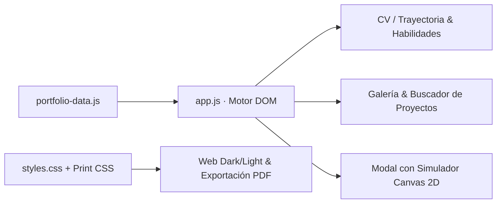

# Portafolio Web & Currículum Vitae — Camilo Castañeda

Sitio web personal e interactivo que centraliza el **Currículum Vitae** y el **Portafolio de Proyectos de Ingeniería** (Arduino, Raspberry Pi, Aplicaciones Web y Procesamiento Digital de Señales RF) de **Camilo Castañeda**.

Diseñado como una aplicación estática **100% libre de dependencias externas**, lista para abrirse localmente en cualquier navegador o desplegarse gratuitamente en **GitHub Pages**.

---

## Características Principales

- **Currículum Vitae Imprimible en PDF**: Botón dedicado y hoja de estilos `@media print` optimizada para exportar una hoja de vida limpia en formato A4/Carta.
- **Terminal Interactiva de Hardware/Software**: Consola simulada en el Hero con comandos ejecutables (`help`, `whoami`, `hardware`, `projects`, `dsp`, `clear`).
- **Simuladores Interactivos por Proyecto**: Modal de vista previa que renderiza en `<canvas>` señales simuladas de telemetría serial Arduino, estado GPIO de Raspberry Pi y espectro FFT en dBFS.
- **Filtros Dinámicos y Buscador**: Filtra competencias y repositorios por categoría (`Arduino & ESP32`, `Raspberry Pi`, `Web Apps`, `DSP & Python`).
- **Modo Oscuro / Claro**: Cambio de tema persistente en `localStorage`.
- **Fuente Única de Datos**: Toda la información del CV se edita fácilmente en [`assets/js/portfolio-data.js`](assets/js/portfolio-data.js).

---

## Arquitectura del Proyecto

---

## Personalización Rápida

1. Abre [`assets/js/portfolio-data.js`](assets/js/portfolio-data.js).
2. Actualiza tu correo (`email`), usuario de GitHub (`githubUsername`), enlace de LinkedIn, experiencia, formación académica y certificaciones.
3. Si cambias tu nombre de usuario de GitHub, reemplaza `camilocastaneda` en las URLs de `PORTFOLIO_DATA`.

---

## Cómo Desplegar en GitHub Pages

1. Sube este repositorio a GitHub.
2. Ve a **Settings → Pages**.
3. En **Source**, selecciona `Deploy from a branch`, rama `main` y carpeta `/ (root)`.
4. Tu currículum web quedará publicado en `https://<tu-usuario>.github.io/01-camilo-castaneda-portfolio-cv/`.

---

## Licencia

Distribuido bajo licencia **MIT**. Consulta el archivo [LICENSE](LICENSE) para más detalles.
